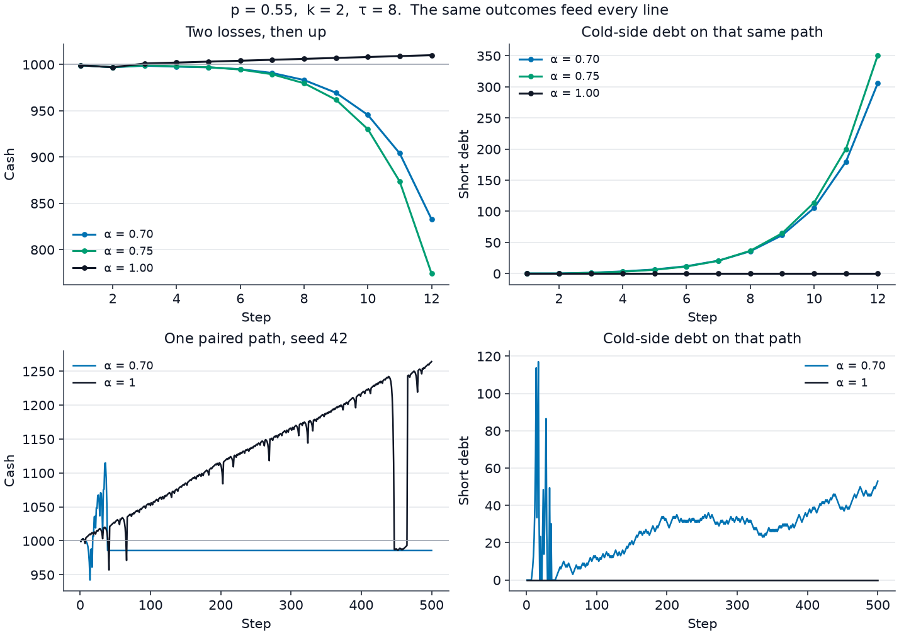
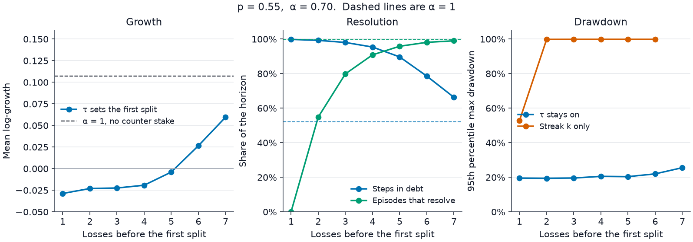
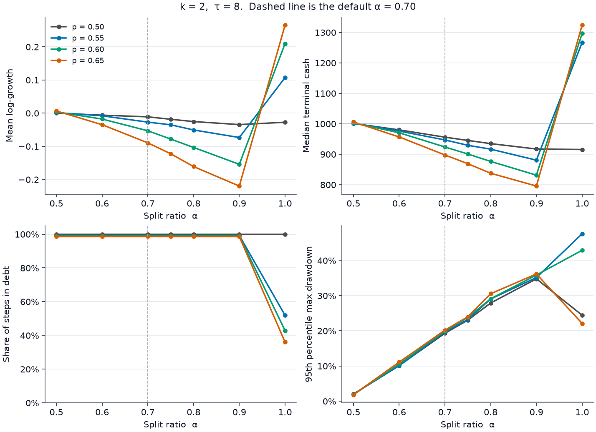

# Branching regimes

Branching does not create positive expectancy when \(p \le 0.5\) under even money, and it does not remove the possibility of ruin under finite capital. It only changes the shape of the path.

This note is about the branching rule alone. The question is when a branch resolves the book, and which \(k\), \(\tau\), \(\alpha\), and \(p\) leave the path in better shape. Names are in [variables.md](variables.md). Stake updates are in [equations.md](equations.md).

The grid is 2000 paired paths, horizon 500, seed 42, capital 1000, base stake 1, depth cap 6, risk cap 0.25. Regenerate it with:

```bash
python src/study_branching.py
```

That writes `results/branching_study.json` and leaves `results/summary.json` alone. The figures below are drawn from that file by `src/plot_branching.py`.

Two clocks are easy to mix up:

- A **lineage reset** is one side's debt returning to zero. The default run does this about 110 times per path.
- A **book resolution** is both debts at zero together. That is the clock used below.

## When a branch is declared

From a fresh base stake the lineage doubles until a trigger fires. After \(m\) losses the debt is \((2^m - 1)b\). The next bet splits when \(m \ge k\) or that debt has reached \(\tau\).

\[
m^{\*}= \min\left(k,\; \text{smallest } m \text{ with } (2^m - 1)b \ge \tau\right)
\]

The split bet settles one step later. With the default \(k = 2\) and \(\tau = 8b\), debt after two losses is \(3b\), which is still under \(8b\). The streak trigger fires first. \(\tau\) does not choose that first branch.

| Losses before the split \(m\) | Debt at the decision | \(\tau\) that fires here if \(k\) is idle | \(\alpha\) that can clear this side in one win |
|---:|---:|---:|---:|
| 1 | \(b\) | \(b\) | 0.50 |
| 2 | \(3b\) | \(3b\) | 0.75 |
| 3 | \(7b\) | \(7b\) | 0.875 |
| 4 | \(15b\) | \(15b\) | 0.9375 |
| 5 | \(31b\) | \(31b\) | 0.96875 |
| 6 | \(63b\) | \(63b\) | 0.984 |
| 7 | \(127b\) | \(127b\) | 0.992 |

The one-win level is \(\alpha \ge D / (D + b)\). Default \(\alpha = 0.70\) is below 0.75, so the default branch does not clear the side that was already in debt.

\(\tau\) matters again after that. Once debt is at least \(\tau\), every later proposal splits, including the bet after a win has reset the streak. Default \(\tau = 8b\) therefore splits almost every bet once the book is wounded. Turning \(\tau\) off and waiting only on \(k\) is a different rule: between splits one side doubles up to the full recovery target. At \(p = 0.55\), \(\alpha = 0.70\), \(k = 2\), that version has median terminal 632 and a 95th-percentile drawdown of 99.8%. The same cell with \(\tau = 8b\) has median terminal 947 and a 95th-percentile drawdown of 19.7%.

The risk budget is \(0.25 \times 1000 = 250\). A recovery target above 250 is replaced by base-sized legs. An unsplit losing run reaches that on the 8th loss, when debt is 255.

## A branch opens a second debt

Up pays the long stake and charges the short stake. Down does the reverse. On any step with both stakes open, one side gains and the other loses. The book cannot return to zero debt on the step the branch settles.

Two losses, then up, at \(k = 2\), \(\tau = 8\), \(p = 0.55\). The favored side is long.

| \(\alpha\) | Stake that just settled | Debt after that up | Cash |
|---:|---|---|---:|
| 0.70 | long 2.8, short 1.2 | long 0.2, short 1.2 | 998.6 |
| 0.75 | long 3.0, short 1.0 | long 0, short 1.0 | 999.0 |
| 1.00 | long 4, short 0 | long 0, short 0 | 1001.0 |

At \(\alpha = 0.75\) the original side does clear. The counter side is born with debt 1. Further ups then raise that cold-side debt through 3, 6, 11, 20, 36. At \(\alpha = 1\) there is no counter stake, the cycle nets one base, and the next bet is the root again.



The top row is that short path. The bottom row is the first path from seed 42 over the full horizon, with \(\alpha = 0.70\) and \(\alpha = 1\) on the same draws. It is one path. \(\alpha = 1\) can still drop sharply. \(\alpha = 0.70\) stays near the starting cash while short debt drifts up.

## How many steps before the branch

At \(p = 0.55\) and \(k = 2\), 45.2% of debt episodes reach the branch. The other 54.8% win first. Those unbranched episodes last a median of 2 steps, and every one of them resolves.

The branched episodes do not. Across the whole grid, with every \(\alpha < 1\), every \(k\), every \(\tau\), and every \(p\) that was run, the share of branched episodes that returned both debts to zero inside 500 steps was zero.

On the default cell the unresolved episode begins at median step 4 and is still open at step 500 on every path. Median resets are 110. The hot side's ending debt has median 6. The cold side's ending debt has median 322, and every path ends with cold-side debt. The resets are real. The book is not back to flat.

Waiting longer pushes that moment out, and more episodes resolve before it arrives.

\(p = 0.55\), \(\alpha = 0.70\), \(k\) held out of the way so \(\tau\) sets \(m^{\*}\).

| Losses before the first split | Steps in debt | Episodes that resolve | Median terminal | Mean log-growth | P95 max drawdown |
|---:|---:|---:|---:|---:|---:|
| 1 | 99.8% | 0% | 942 | −0.029 | 19.5% |
| 2 | 99.2% | 54.8% | 947 | −0.023 | 19.4% |
| 3 | 98.0% | 79.8% | 950 | −0.022 | 19.5% |
| 4 | 95.3% | 90.8% | 954 | −0.019 | 20.5% |
| 5 | 89.6% | 95.8% | 974 | −0.004 | 20.3% |
| 6 | 78.5% | 98.1% | 993 | +0.026 | 21.9% |
| 7 | 66.2% | 98.9% | 1064 | +0.059 | 25.5% |
| no split (\(\alpha = 1\)) | 51.9% | 99.5% | 1267 | +0.107 | 47.6% |



The resolved episodes are the ones that won before \(m^{\*}\). Their median length stays 2 steps. Later \(m^{\*}\) means more of those short cycles and less time carrying a branch. \(\alpha = 1\) is the same engine with a zero counter stake, still under the risk cap. On the right, leaving \(\tau\) off lets one side double between streak triggers, and the 95th-percentile drawdown sits near 100% after the second loss.

## Which ratio

\(\alpha\) does not decide whether the first branch happens. \(k\), \(\tau\), and \(p\) do. \(\alpha\) scales the two legs: \(\alpha\) stays on the side already in debt, and \(1 - \alpha\) opens the other side.

At default \(k = 2\), \(\tau = 8b\):

| \(p\) | \(\alpha\) | Steps in debt | Episodes that resolve | Median terminal | Mean log-growth | Median max drawdown | P95 max drawdown | Paths above start |
|---:|---:|---:|---:|---:|---:|---:|---:|---:|
| 0.50 | 0.50 | 100% | 0% | 1000 | 0.000 | 0.7% | 2.0% | 51.5% |
| 0.50 | 0.70 | 100% | 0% | 956 | −0.011 | 12.8% | 19.3% | 38.4% |
| 0.50 | 0.90 | 100% | 0% | 917 | −0.035 | 22.4% | 34.8% | 37.2% |
| 0.50 | 1.00 | 100% | 0% | 916 | −0.028 | 21.2% | 24.4% | 36.2% |
| 0.55 | 0.50 | 99.2% | 54.8% | 1002 | +0.001 | 0.7% | 2.0% | 55.8% |
| 0.55 | 0.70 | 99.2% | 54.8% | 947 | −0.027 | 13.2% | 19.7% | 33.0% |
| 0.55 | 0.75 | 99.2% | 54.8% | 929 | −0.035 | 15.8% | 23.2% | 33.5% |
| 0.55 | 0.90 | 99.2% | 54.8% | 880 | −0.074 | 23.1% | 35.1% | 31.8% |
| 0.55 | 1.00 | 51.9% | 99.5% | 1267 | +0.107 | 11.5% | 47.6% | 80.2% |
| 0.65 | 0.50 | 98.6% | 65.0% | 1006 | +0.007 | 0.6% | 1.8% | 75.0% |
| 0.65 | 0.70 | 98.6% | 65.0% | 898 | −0.090 | 14.3% | 20.2% | 15.0% |
| 0.65 | 0.90 | 98.6% | 65.0% | 796 | −0.220 | 26.5% | 36.1% | 5.6% |
| 0.65 | 1.00 | 36.0% | 99.7% | 1324 | +0.266 | 3.0% | 22.1% | 97.8% |



At \(p = 0.50\) the root itself opens \(b/2\) on each side, so the book is two-sided from the first loss even at \(\alpha = 1\). Equal split holds terminal wealth on 1000 and holds drawdown near 1%. It never resolves.

For a real split, the small ratio is the one that disturbs the path the least. \(\alpha = 0.50\) keeps the median terminal near the starting capital and the drawdown near 2%. Raising \(\alpha\) toward 0.90 lowers terminal wealth and deepens the drawdown. The fast resolution is the other end, \(\alpha = 1\), where the counter leg is zero.

## Which probability

The root bets the favored side. \(P(\text{up}) = 0.45\) is the same experiment as \(P(\text{up}) = 0.55\), with long and short swapped. The grid matches on that mirror. Read \(p\) as the win probability of the side the root bets: 0.50, 0.55, 0.60, 0.65.

A higher favored-win probability makes \(\alpha = 1\) resolve faster and grow more. The same change makes a real split worse. At \(\alpha = 0.70\) the mean log-growth goes from −0.011 at \(p = 0.50\), to −0.027 at \(p = 0.55\), to −0.090 at \(p = 0.65\). The cold side is the hedge. The hot side winning more often is the cold side losing more often, and the ending cold-side debt rises (median 322 at \(p = 0.55\), median 446 at \(p = 0.65\)).

## What to set

For a book that returns to flat inside this horizon, set \(\alpha = 1\), or set the first trigger late enough that most episodes win before it. At \(p = 0.55\) the late trigger \(\tau = 127b\) (\(m^{\*} = 7\)) has mean log-growth +0.059. \(\alpha = 1\) on the same paths has +0.107. Both sit under the risk cap, so ruin on these 2000 paths is zero.

For a split that is going to happen, \(\alpha = 0.50\) is the ratio that keeps drawdown and terminal wealth closest to the starting capital. It is the slow ratio: the branched book stays open through the horizon.

Keep \(\tau\) on. It is the control that stops a wounded lineage from doubling alone.

The depth cap binds on 62.8% of default paths. Past depth 6 the engine stops opening a new generation and bets at most base against whatever debt is left. That is another reason a wounded book sits still for the rest of the horizon.

Uncapped pure martingale on these same \(p = 0.55\) paths has median terminal 1273, ruin 9.35%, and mean log-growth −0.427. The capped single-sided rule (\(\alpha = 1\)) has median terminal 1267, ruin 0, and mean log-growth +0.107. The cap is what removes the ruin. The split is what moves debt onto the cold side.
