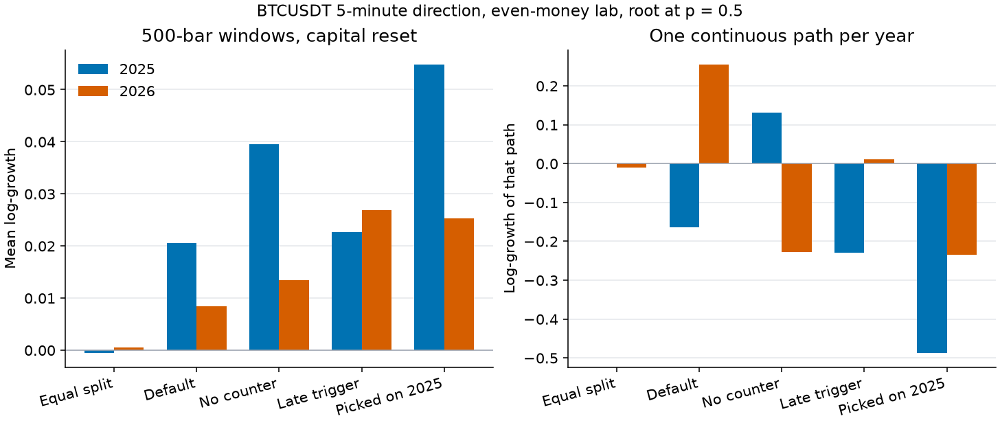

# Bitcoin 5-minute replay

Branching does not create positive expectancy when \(p \le 0.5\) under even money, and it does not remove the possibility of ruin under finite capital. It only changes the shape of the path.

This is the same branching engine as [branching_regimes.md](branching_regimes.md), fed with historical direction bits instead of coin flips.

## What a bar is

Source: Binance spot BTCUSDT 5-minute klines, January 2025 through September 2026. October 2026 was not published yet. QuantConnect project [37996630](https://www.quantconnect.com/project/37996630) (`groky_carlo`) is still the empty Python starter. No QuantConnect dataset was purchased. Local Lean crypto files do not cover this span.

| | |
|---|---|
| Bars | 183,744 |
| Flat (close = open), dropped | 541 |
| Decisive bars | 183,203 |
| First bar | 2025-01-01 00:00 UTC, open 93,576 |
| Last bar | 2026-09-30 23:55 UTC, close 83,623.6 |
| Bitcoin price, 2025 | −6.3% |
| Bitcoin price, 2026 through September | −4.6% |

Up means close > open. Down means close < open. The engine is paid even money on that bit. It is not paid the bitcoin move. The price fell while the bit stayed a coin flip, because down bars were larger than up bars.

## The bit is a fair coin

2025 up rate 0.4996, standard error 0.0015. 2026 up rate 0.4989. That is inside noise of one half, so the root opens both sides (\(p = 0.5\)).

Runs are short. In 2025 the median run is 2 bars and the 95th percentile is 5. The longest run in either year is 18 bars. Lag-1 agreement is 0.499 in 2025, against 0.500 for independent draws at this up rate. 2026 agrees on the next bar 0.489 of the time, a small tilt toward alternation.

## How the test is split

A window is 500 decisive bars, the lab horizon, and each window starts again at cash 1,000. There are 210 windows in 2025 and 156 in 2026. Settings are chosen by mean log-growth on the 2025 windows. 2026 is not used for that choice.

The grid is \(\alpha \in \{0.50, 0.60, 0.70, 0.80, 0.90, 1\}\), \(k \in \{1, 2, 3, 4, 6, 8\}\), \(\tau \in \{8, 15, 31, 63, 127\}\), with one cell at \(\alpha = 1\). Depth cap 6, risk cap 0.25, base stake 1.

Regenerate with `python src/btc_replay.py`. The figure is `python src/plot_btc.py`.

## Restarted windows

| Setting | 2025 mean log-growth | 2026 mean log-growth | 2025 median terminal | 2026 median terminal | 2026 P95 max drawdown |
|---|---:|---:|---:|---:|---:|
| Equal split, \(\alpha = 0.50\), \(k = 2\), \(\tau = 8\) | 0.000 | +0.001 | 999 | 1,001 | 1.9% |
| Default, \(\alpha = 0.70\), \(k = 2\), \(\tau = 8\) | +0.021 | +0.008 | 985 | 974 | 18.4% |
| No counter, \(\alpha = 1\), \(k = 2\), \(\tau = 8\) | +0.040 | +0.014 | 993 | 926 | 24.4% |
| Late trigger, \(\alpha = 0.70\), \(k = 8\), \(\tau = 127\) | +0.023 | +0.027 | 976 | 962 | 26.1% |
| Picked on 2025, \(\alpha = 0.90\), \(k = 8\), \(\tau = 127\) | +0.055 | +0.025 | 1,013 | 1,003 | 40.4% |

Ruin is zero in every one of these window cells. The 2025 search likes a high ratio and a late trigger. On 2026 that cell's mean log-growth falls from +0.055 to +0.025, which is the same neighborhood as the late trigger that was not fit to 2025. About half of the picked windows finish above the start. The 95th-percentile drawdown is about 40%.

Equal split does not grow. It also does not draw down: the window stays within about 2% of the starting cash.

## The path you would actually sit in

A window throws the debt away every 500 bars. A year does not. These are single paths, one per year, with no reset.

| Setting | 2025 cash | 2025 log-growth | 2026 cash | 2026 log-growth | Debts at the 2026 close, long / short |
|---|---:|---:|---:|---:|---|
| Equal split | 1,001 | +0.001 | 990 | −0.010 | 433 / 144 |
| Default | 849 | −0.164 | 1,291 | +0.256 | 282 / 208 |
| No counter | 1,140 | +0.131 | 797 | −0.228 | 424 / 144 |
| Late trigger | 794 | −0.230 | 1,011 | +0.011 | 282 / 187 |
| Picked on 2025 | 615 | −0.487 | 791 | −0.235 | 282 / 279 |

The setting that won the 2025 window search loses cash in both years when it is left running, and both sides still hold debt at the end. The default rule's 2026 cash finishes at 1,291 and its 2025 cash finishes at 849. That is one path each year, and both of them end with a few hundred units of debt still open. Equal split is the rule that keeps cash near 1,000 across the whole file. The book is still not flat.

## What changed relative to the coin-flip lab

The synthetic lab at \(p = 0.55\) was a biased coin with long losing runs. These bars are a fair coin with short runs, so a 500-bar window almost never ruins under the risk cap. The part that carries over is the bookkeeping: a real split leaves lineage debt that a fresh window never has to repay. Optimizing the fresh window picks a late, lopsided branch. Sitting in that branch for a year gives the debt time to stay open, and the cash ends lower than it started.
