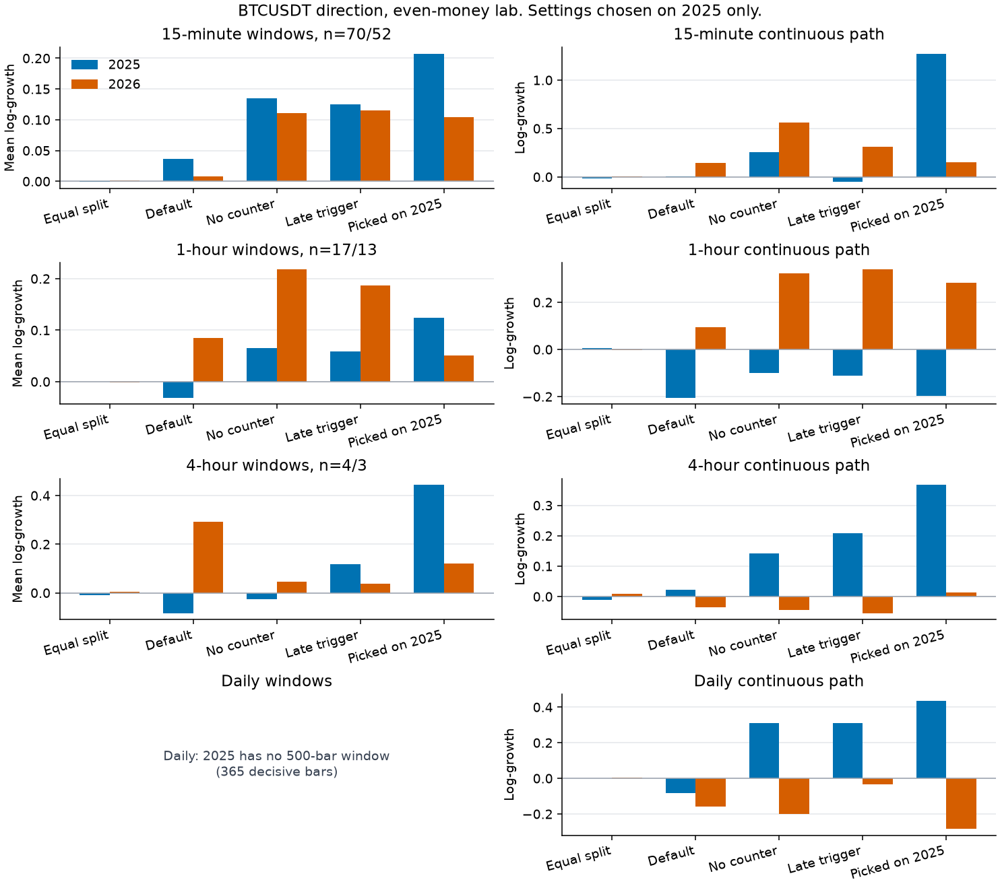

# Bitcoin timeframe replay

Branching does not create positive expectancy when \(p \le 0.5\) under even money, and it does not remove the possibility of ruin under finite capital. It only changes the shape of the path.

This is the same branching engine, the same grid, and the same even-money up/down bit as [btc_replay.md](btc_replay.md), run on 15-minute, 1-hour, 4-hour, and daily Binance spot BTCUSDT bars.

## What a bar is

Source: Binance monthly klines, January 2025 through September 2026. October 2026 was not published yet. QuantConnect project [37996630](https://www.quantconnect.com/project/37996630) (`groky_carlo`) is still the empty Python starter. No QuantConnect dataset was purchased.

Every timeframe opens 2025 at 93,576 and closes September 2026 at 83,623.6. Bitcoin's price fell 6.3% in 2025 and 4.6% from January through September 2026, about 10.6% over the whole span. The engine is paid even money on the direction bit. It is not paid that move.

| Timeframe | Bars | Flat, dropped | Decisive | 2025 windows | 2026 windows | Bars left out of the windows, 2025 / 2026 |
|---|---:|---:|---:|---:|---:|---|
| 15-minute | 61,248 | 29 | 61,219 | 70 | 52 | 31 / 188 |
| 1-hour | 15,312 | 1 | 15,311 | 17 | 13 | 260 / 51 |
| 4-hour | 3,828 | 0 | 3,828 | 4 | 3 | 190 / 138 |
| Daily | 638 | 0 | 638 | 0 | 0 | 365 / 273 |

Up means close > open. Down means close < open. A flat daily or 4-hour bar did not occur in this file.

## The bit is a fair coin at every timeframe

| Timeframe | 2025 up rate | Standard error | 2026 up rate | 2025 lag-1 same | 2026 lag-1 same | Median run, 2025 / 2026 | P95 run | Longest run |
|---|---:|---:|---:|---:|---:|---|---|---|
| 15-minute | 0.4993 | 0.0027 | 0.4967 | 0.483 | 0.479 | 1 / 1 | 4 / 4 | 16 / 13 |
| 1-hour | 0.5034 | 0.0053 | 0.4984 | 0.487 | 0.477 | 2 / 2 | 5 / 4 | 14 / 8 |
| 4-hour | 0.5046 | 0.0107 | 0.5043 | 0.477 | 0.460 | 1 / 1 | 4 / 4 | 8 / 11 |
| Daily | 0.5014 | 0.0262 | 0.4908 | 0.492 | 0.518 | 2 / 2 | 4 / 5 | 7 / 8 |

An independent series at these up rates would agree with the previous bar about half the time. Each 2025 up rate is inside one percentage point of one half, and inside its standard error, so the root opens both sides (\(p = 0.5\)) on every timeframe.

Streaks stay short in bars. The median run is one or two bars, and the longest run in the file is 16 fifteen-minute bars. A coarser candle does not hand the debt rule a longer streak. The 15-minute, 1-hour, and 4-hour series agree with the previous bar a bit less than half the time. The daily series in 2025 is close to independent, and in 2026 it agrees with the previous day 0.518 of the time.

## How the test is split

A window is 500 decisive bars, the lab horizon, and it has to start and end inside one calendar year. Each window starts again at cash 1,000. The leftover bars at the end of a year stay out of the window score and stay in the continuous path.

The daily series has 365 decisive bars in 2025, so a 500-bar window does not exist. That timeframe is ranked by log-growth of the single continuous 2025 path. One path is not a sample.

The 4-hour series has four windows in 2025 and three in 2026. The 1-hour series has 17 and 13. Those means move when a single window moves.

The grid is \(\alpha \in \{0.50, 0.60, 0.70, 0.80, 0.90, 1\}\), \(k \in \{1, 2, 3, 4, 6, 8\}\), \(\tau \in \{8, 15, 31, 63, 127\}\), with one cell at \(\alpha = 1\). That is 151 cells. Depth cap 6, risk cap 0.25, base stake 1. Settings are chosen on 2025. 2026 is not used for that choice.

The 5-minute note labels a window by its first bar, so a window there can cross New Year by about two days. These windows do not cross.

Regenerate with `python src/btc_timeframes.py`. The figure is `python src/plot_timeframes.py`.

## Restarted windows

Ruin is zero in every cell below. The drawdown column is the nearest-rank 95th percentile of each window's maximum drawdown. With 13 hourly holdout windows, and with 3 four-hour holdout windows, that rank is the worst window.

| Timeframe | Setting | 2025 mean log-growth | 2026 mean log-growth | 2025 median terminal | 2026 median terminal | 2026 P95 max drawdown |
|---|---|---:|---:|---:|---:|---:|
| 15-minute | Equal split, \(\alpha = 0.50\), \(k = 2\), \(\tau = 8\) | −0.001 | +0.002 | 1,000 | 1,002 | 2.0% |
| 15-minute | Default, \(\alpha = 0.70\), \(k = 2\), \(\tau = 8\) | +0.036 | +0.008 | 989 | 982 | 18.4% |
| 15-minute | No counter, \(\alpha = 1\), \(k = 2\), \(\tau = 8\) | +0.135 | +0.111 | 1,154 | 1,084 | 24.1% |
| 15-minute | Late trigger, \(\alpha = 0.70\), \(k = 8\), \(\tau = 127\) | +0.125 | +0.115 | 1,136 | 1,074 | 24.5% |
| 15-minute | Picked, \(\alpha = 0.90\), \(k = 8\), \(\tau = 127\) | +0.207 | +0.104 | 1,495 | 1,486 | 39.8% |
| 1-hour | Equal split, \(\alpha = 0.50\), \(k = 2\), \(\tau = 8\) | 0.000 | −0.002 | 1,000 | 998 | 2.1% |
| 1-hour | Default, \(\alpha = 0.70\), \(k = 2\), \(\tau = 8\) | −0.031 | +0.085 | 946 | 1,097 | 16.3% |
| 1-hour | No counter, \(\alpha = 1\), \(k = 2\), \(\tau = 8\) | +0.065 | +0.218 | 1,046 | 1,493 | 24.1% |
| 1-hour | Late trigger, \(\alpha = 0.70\), \(k = 8\), \(\tau = 127\) | +0.058 | +0.186 | 972 | 1,307 | 22.6% |
| 1-hour | Picked, \(\alpha = 0.80\), \(k = 1\), \(\tau = 127\) | +0.124 | +0.051 | 1,100 | 1,043 | 31.2% |
| 4-hour | Equal split, \(\alpha = 0.50\), \(k = 2\), \(\tau = 8\) | −0.009 | +0.004 | 991 | 1,001 | 1.0% |
| 4-hour | Default, \(\alpha = 0.70\), \(k = 2\), \(\tau = 8\) | −0.084 | +0.291 | 912 | 1,440 | 12.7% |
| 4-hour | No counter, \(\alpha = 1\), \(k = 2\), \(\tau = 8\) | −0.027 | +0.047 | 987 | 1,055 | 20.5% |
| 4-hour | Late trigger, \(\alpha = 0.70\), \(k = 8\), \(\tau = 127\) | +0.118 | +0.037 | 1,125 | 1,046 | 21.3% |
| 4-hour | Picked, \(\alpha = 0.80\), \(k = 4\), \(\tau = 15\) | +0.444 | +0.120 | 1,558 | 1,180 | 17.9% |

On the 15-minute bars the top of the grid is a band of \(\alpha = 0.90\) with a late first split. The best cell is the same cell the 5-minute search picked. Its mean log-growth falls from +0.207 on 70 windows to +0.104 on 52. That holdout sits next to the no-counter and late-trigger cells, which were not fit to 2025. The 2025 median terminal is 1,495 and the 2025 mean terminal is 1,277, so a minority of windows finish well below the center. About 77% of the 2025 windows finish above the start, and about 60% of the 2026 windows do. The 2026 drawdown percentile is about 40%.

On the 1-hour bars the search picks an early split, \(k = 1\), with the debt trigger at 127. Seventeen windows is a small sample, and the top ten cells do not share one \((k, \tau)\). The holdout mean log-growth is +0.051. The no-counter and late-trigger cells, which 2025 did not select, print +0.218 and +0.186 on those same 13 windows.

On the 4-hour bars the +0.444 is the best of 151 cells on four windows. Mean and median terminal on those four are both about 1,560, and all four finish above the start, so one window is not carrying the mean. \(k = 6\) and \(k = 8\) at the same \(\alpha\) and \(\tau\) tie that score; the table lists \(k = 4\), the first of the tie. The three-window holdout falls to +0.120. On those three windows the default rule, which lost on the four training windows, prints a higher mean than the searched cell.

Equal split stays within about 1% of the starting cash in every window cell above. It also has the smallest drawdown in every row.

## The path you would actually sit in

A window throws the debt away every 500 bars. A year does not. Each row is one path, started at cash 1,000, with no reset. The daily pick is the rule that won that single 2025 path. The other picks were chosen on windows, and the path is the year those settings then had to sit through.

| Timeframe | Setting | 2025 cash | 2025 log-growth | 2026 cash | 2026 log-growth | Debts at the 2026 close, long / short |
|---|---|---:|---:|---:|---:|---|
| 15-minute | Equal split | 987 | −0.014 | 1,005 | +0.005 | 458 / 40 |
| 15-minute | Default | 1,005 | +0.005 | 1,153 | +0.142 | 221 / 139 |
| 15-minute | No counter | 1,291 | +0.255 | 1,757 | +0.563 | 221 / 77 |
| 15-minute | Late trigger | 949 | −0.052 | 1,362 | +0.309 | 457 / 40 |
| 15-minute | Picked on 2025 | 3,571 | +1.273 | 1,165 | +0.153 | 630 / 40 |
| 1-hour | Equal split | 1,006 | +0.006 | 996 | −0.004 | 291 / 48 |
| 1-hour | Default | 815 | −0.204 | 1,097 | +0.093 | 32 / 396 |
| 1-hour | No counter | 905 | −0.100 | 1,380 | +0.322 | 265 / 48 |
| 1-hour | Late trigger | 896 | −0.110 | 1,405 | +0.340 | 384 / 48 |
| 1-hour | Picked on 2025 | 820 | −0.198 | 1,327 | +0.283 | 335 / 48 |
| 4-hour | Equal split | 989 | −0.011 | 1,010 | +0.010 | 3 / 360 |
| 4-hour | Default | 1,023 | +0.022 | 965 | −0.035 | 3 / 262 |
| 4-hour | No counter | 1,152 | +0.142 | 957 | −0.044 | 238 / 36 |
| 4-hour | Late trigger | 1,231 | +0.208 | 947 | −0.055 | 351 / 36 |
| 4-hour | Picked on 2025 | 1,444 | +0.367 | 1,015 | +0.015 | 283 / 36 |
| Daily | Equal split | 1,002 | +0.002 | 1,006 | +0.006 | 355 / 10 |
| Daily | Default | 920 | −0.084 | 853 | −0.159 | 334 / 10 |
| Daily | No counter | 1,364 | +0.310 | 820 | −0.199 | 7 / 255 |
| Daily | Late trigger | 1,362 | +0.309 | 968 | −0.033 | 279 / 10 |
| Daily | Picked on 2025 | 1,548 | +0.437 | 753 | −0.283 | 383 / 10 |

The 15-minute picked cell makes a large profit on the 2025 path and a smaller one on the 2026 path, and it ends 2026 with 630 of long debt still open against 1,165 of cash. The 1-hour picked cell loses the 2025 path it would have sat in, cash 820, and finishes 2026 at 1,327 with debt still open on both sides. The 4-hour picked cell ends 2025 at 1,444 and 2026 at 1,015, on a year that contained four windows and three windows. The daily cell chosen because it won the only 2025 path finishes that year at 1,548 and finishes the 2026 path at 753, the lowest 2026 cash of the five daily rows. Its 2026 maximum drawdown is 25%.

Equal split is the row that leaves cash near 1,000 on every continuous year of every timeframe. The largest departure in that row is the 15-minute 2025 close at 987. The book is still not flat: several of those years end with a few hundred units of debt on one side.

The daily no-counter path in 2026 ends with short debt 255. That is the point where the risk budget has replaced the recovery target with base-sized legs. The cap is what keeps a long losing streak from doubling through the bankroll. It has not cleared the lineage.

## What carries across the timeframes

The direction bit stays a coin while the price falls, because down bars are larger than up bars. The same was true on the 5-minute file.

An adapted even-money stake at \(p = 0.5\) has expectation equal to the cash it starts with. A 2025 window mean above zero is a description of this file after a search over 151 cells. The holdout is the check, and on every timeframe that has windows the searched cell's mean log-growth is smaller in 2026 than in 2025.

The winning cell is not the same cell at every timeframe. Fifteen minutes agrees with the 5-minute pick, a late lopsided branch. One hour wants a branch on the first loss. Four hours, on four windows, wants \(\alpha = 0.80\) and an earlier debt trigger. Daily, on one path, wants \(\alpha = 0.80\) and \(k = 1\).

Where the sample is large enough to compare, the holdout of the searched cell lands in the neighborhood of rules the search did not pick. On 15-minute bars that neighborhood is the no-counter and late-trigger window scores. On 1-hour bars the searched cell's holdout is below both. Short streaks are why the risk cap keeps window ruin at zero here, and why a fresh window can look calm while the year-long book still carries the other side's debt.
