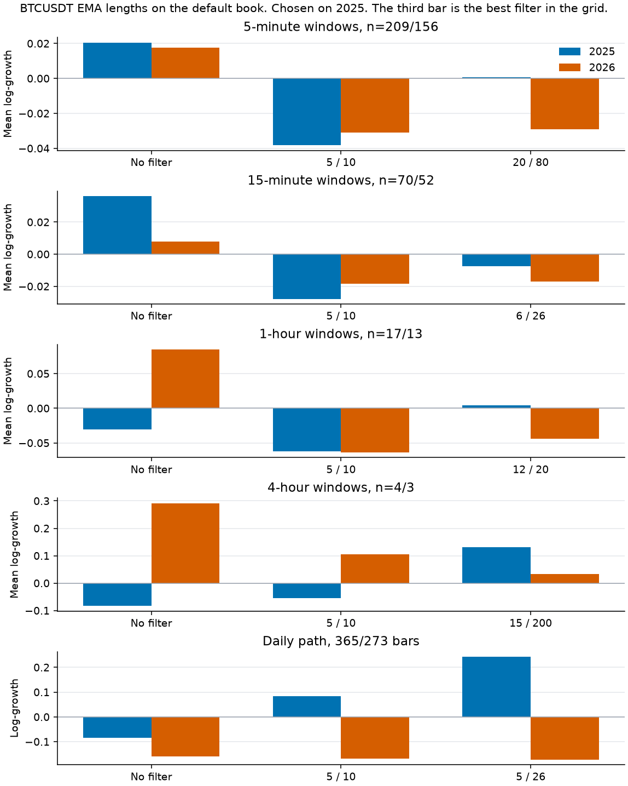

# EMA length search

Branching does not create positive expectancy when \(p \le 0.5\) under even money, and it does not remove the possibility of ruin under finite capital. It only changes the shape of the path.

This search asks which fast and slow EMA lengths to hand the dominant-side filter, on Binance spot BTCUSDT, for the five timeframes already replayed: 5-minute, 15-minute, 1-hour, 4-hour, and daily. The branching book stays the lab default: \(\alpha = 0.70\), \(k = 2\), \(\tau = 8\), \(p = 0.5\). 2025 chooses the pair. 2026 is held out.

The chosen pair is the best filter in a grid of 132. On the 5-minute and 15-minute windows, every pair in that grid, including the chosen one, scores below the book with the filter left off.

## What was searched

Fast lengths are 2, 3, 4, 5, 6, 8, 10, 12, 15, 20, 30. Slow lengths are 8, 10, 12, 15, 20, 26, 30, 40, 50, 60, 80, 100, 150, 200. A pair is kept only when the fast length is shorter than the slow length. That is 132 pairs, and the starting pair 5 / 10 is one of them. Those lists live in `src/optimize_ema.py`. The EMA update in `src/ema.py` still takes the lengths as arguments. `DEFAULT_FAST_LENGTH` and `DEFAULT_SLOW_LENGTH` are still 5 and 10.

The average is the one in [equations.md](equations.md): the first ready value is the simple moving average of the first `length` closes, then the Lean update with smoothing \(2/(\mathrm{length}+1)\). The stake that settles on bar \(t\) uses closes from before \(t\). The first `slow` bars have no read. The average is computed once on the full series of decisive closes, then sliced with each window. It is not restarted inside a window. A flat bar is dropped and does not update the average.

Bars are the same Binance monthly klines as [btc_replay.md](btc_replay.md) and [btc_timeframes.md](btc_timeframes.md): January 2025 through September 2026. October 2026 was not published. Up means close > open. The engine is paid even money on that bit. It is not paid the bitcoin return. Price fell 6.3% in 2025 and 4.6% through September 2026, from 93,576 to 83,623.6.

Each 2025 up rate is inside one percentage point of one half, and inside its standard error, so the unfiltered root opens both sides. A fresh root with no read stakes half a unit on each side. A fresh root with a read stakes one unit on the dominant side. The total stake is one unit either way. The net exposure is zero in the first case and one unit in the second. The filter also aims the alpha share of a split, and it chooses which leg is funded first when the risk cap trims a book. An unsplit double stays on the lineage that holds the debt.

Windows are 500 decisive bars that start and end inside one calendar year. Each window starts again at cash 1,000. Daily 2025 has 365 decisive bars, so that timeframe is ranked by log-growth of the single continuous 2025 path. One path is not a sample. The 4-hour series has four windows in 2025 and three in 2026. The 1-hour series has 17 and 13. Ties keep the smaller fast length, then the smaller slow length, after a lower median window drawdown (path drawdown on the daily series).

The same lengths are then applied, without refitting, to the \((\alpha, k, \tau)\) cell each timeframe had already picked with no filter. That side check is reported. It is not used to choose.

QuantConnect project [37996630](https://www.quantconnect.com/project/37996630) plots this crossover. It does not run the branching book. This search did not launch a cloud optimization and did not buy a dataset. The grid ran locally on the Binance bars the lab already scores. The 5-minute run took 78 seconds, and all five timeframes took about two minutes.

Regenerate with `python src/optimize_ema.py`. The figure is `python src/plot_ema.py`.

## Clock span of the chosen lengths

The same bar count is a different amount of clock time on each timeframe.

| Timeframe | Chosen fast / slow | Clock span | 2025 bars with no read |
|---|---|---|---:|
| 5-minute | 20 / 80 | 100 minutes / 6 hours 40 minutes | 80 |
| 15-minute | 6 / 26 | 90 minutes / 6 hours 30 minutes | 26 |
| 1-hour | 12 / 20 | 12 hours / 20 hours | 20 |
| 4-hour | 15 / 200 | 2.5 days / 33.3 days | 200 |
| Daily | 5 / 26 | 5 days / 26 days | 26 |

A slow length of 200 on a 4-hour bar is unread for the first 200 bars of 2025. The first 500-bar window is 40% unread.

## Restarted windows

Ruin is zero in every window cell below. The drawdown column is the nearest-rank 95th percentile of each window's maximum drawdown. With 13 hourly holdout windows, and with 3 four-hour holdout windows, that rank is the worst window.

| Timeframe | Pair | 2025 mean log-growth | 2026 mean log-growth | 2025 median terminal | 2026 median terminal | 2026 P95 max drawdown |
|---|---|---:|---:|---:|---:|---:|
| 5-minute | No filter | +0.021 | +0.017 | 984 | 992 | 17.8% |
| 5-minute | 5 / 10 | −0.038 | −0.031 | 935 | 941 | 22.0% |
| 5-minute | Chosen, 20 / 80 | +0.001 | −0.029 | 971 | 938 | 22.6% |
| 15-minute | No filter | +0.036 | +0.008 | 989 | 982 | 18.4% |
| 15-minute | 5 / 10 | −0.028 | −0.018 | 980 | 985 | 22.9% |
| 15-minute | Chosen, 6 / 26 | −0.007 | −0.017 | 985 | 984 | 23.7% |
| 1-hour | No filter | −0.031 | +0.085 | 946 | 1,097 | 16.3% |
| 1-hour | 5 / 10 | −0.062 | −0.064 | 929 | 945 | 21.8% |
| 1-hour | Chosen, 12 / 20 | +0.005 | −0.044 | 991 | 909 | 25.8% |
| 4-hour | No filter | −0.084 | +0.291 | 912 | 1,440 | 12.8% |
| 4-hour | 5 / 10 | −0.054 | +0.105 | 963 | 1,042 | 13.6% |
| 4-hour | Chosen, 15 / 200 | +0.131 | +0.033 | 1,099 | 1,045 | 12.0% |

On the 5-minute bars, 209 windows in 2025 and 156 in 2026, zero of the 132 pairs beat the unfiltered book. The best filter prints about +0.001 against +0.021 unfiltered. Its 2026 mean is −0.029, against +0.017 with the filter off. The top ten training scores are all at or below +0.001, and every one of those ten is negative on the holdout. The starting pair 5 / 10 is worse than the chosen pair and worse than no filter on both years.

On the 15-minute bars, 70 and 52 windows, zero pairs beat the unfiltered book either. The chosen pair is −0.007 on 2025 and −0.017 on 2026. The unfiltered book is +0.036 and +0.008. The whole top ten is negative on the training windows.

On the 1-hour bars the unfiltered 2025 mean is itself negative, −0.031, so 19 pairs beat it. The winner is 12 / 20 at +0.005. The same 13 holdout windows print −0.044 for that pair and +0.085 with the filter off. Pairs that 2025 did not select print a positive holdout: 4 / 50 is +0.030, 10 / 20 is +0.020, and 12 / 15 is +0.020. Seventeen windows is a small sample to rank 132 pairs on.

On the 4-hour bars the unfiltered 2025 mean is −0.084, and 112 pairs beat it. The winner, 15 / 200, prints +0.131 on four windows, all four finish above the start, and the median terminal is 1,099. The three-window holdout is +0.033. The unfiltered book prints +0.291 on those same three windows. Inside the grid, 6 / 200 holds out at +0.181 and 8 / 200 at +0.220. Four windows will crown a slow length of 200 because the first window is mostly unread and the remaining three are one short sample. That +0.131 is the best of 132 looks, not a measured edge.

## The path you would actually sit in

A window restarts at cash 1,000. The continuous path does not. On the default book the recovery proposal soon exceeds the risk budget, \(B = 0.25 \times 1000 = 250\). The cap then keeps one base stake on each side. Net exposure is zero, so cash stops moving. Debts keep transferring one unit a bar. A crossover that is still unread when cash freezes copies the unfiltered year, including the ending debts.

On the 5-minute 2025 path that freeze is settled step 37. Cash is already 848.7, the year-end cash, and it stays there for the remaining 104,785 bars. The slow length has to be at least 40 before its first read falls after that step. All 77 pairs with a slow length of 40 or more share the unfiltered 2025 path. The chosen pair, 20 / 80, is one of them: same cash 848.7, same ending debts 222.0 and 249.5. The starting pair 5 / 10 is ready at bar 10 and has already diverged by step 12. Its 2025 path finishes at 906.6. The 2026 path is a new book at cash 1,000 with the average already warm, so 20 / 80 does change that year: 934.7 against 1,291.2 unfiltered.

The same freeze binds on the 1-hour 2025 path by step 23, and 97 pairs share the unfiltered year. It binds on the daily 2025 path by step 40, and 77 pairs share that year. The daily ranking is this path, so those 77 pairs tie the unfiltered log-growth and lose to any pair that diverges earlier. 5 / 26 does diverge: 2025 cash goes from 919.5 to 1,274.0. 6 / 26 ties that path on both years, and the stable sort keeps 5 / 26.

The 15-minute and 4-hour years also finish in that zero-exposure state, which is why 44 and 22 pairs still share the unfiltered 2025 path. The chosen 4-hour pair, 15 / 200, is one of them: cash 1,022.6 and debts 13.0 and 327.7 match the unfiltered year exactly. The window score still separates these pairs, because each window opens a new book and a warm average changes the root.

| Timeframe | Pair | 2025 path cash | 2026 path cash | 2025 log-growth | 2026 log-growth |
|---|---|---:|---:|---:|---:|
| 5-minute | No filter | 848.7 | 1,291.2 | −0.164 | +0.256 |
| 5-minute | 5 / 10 | 906.6 | 1,100.3 | −0.098 | +0.096 |
| 5-minute | 20 / 80 | 848.7 | 934.7 | −0.164 | −0.068 |
| 15-minute | No filter | 1,004.8 | 1,152.9 | +0.005 | +0.142 |
| 15-minute | 5 / 10 | 1,276.4 | 906.1 | +0.244 | −0.099 |
| 15-minute | 6 / 26 | 940.0 | 800.4 | −0.062 | −0.223 |
| 1-hour | No filter | 815.4 | 1,097.4 | −0.204 | +0.093 |
| 1-hour | 5 / 10 | 1,321.2 | 944.7 | +0.279 | −0.057 |
| 1-hour | 12 / 20 | 990.7 | 854.9 | −0.009 | −0.157 |
| 4-hour | No filter | 1,022.6 | 965.3 | +0.022 | −0.035 |
| 4-hour | 5 / 10 | 952.2 | 1,316.2 | −0.049 | +0.275 |
| 4-hour | 15 / 200 | 1,022.6 | 892.5 | +0.022 | −0.114 |
| Daily | No filter | 919.5 | 852.7 | −0.084 | −0.159 |
| Daily | 5 / 10 | 1,087.2 | 845.6 | +0.084 | −0.168 |
| Daily | 5 / 26 | 1,274.0 | 841.8 | +0.242 | −0.172 |

The daily series has no 500-bar window. 5 / 26 is the 2025 path winner among 132 pairs, one of 24 that beat the unfiltered path. The 2026 path gives it back: 841.8, against 852.7 unfiltered and 845.6 for 5 / 10. Maximum drawdown on that chosen path is 7.4% in 2025 and 20.6% in 2026. Ending debt is still open on every row above.

## Which side the crossover calls

The read is used as a trend filter: fast above slow means the next stake prefers long. On these files the next bar leans the other way.

| Timeframe | Pair | 2025 up rate when long | 2025 up rate when short | 2026 up rate when long | 2026 up rate when short |
|---|---|---:|---:|---:|---:|
| 5-minute | 20 / 80 | 0.496 | 0.503 | 0.488 | 0.510 |
| 5-minute | 5 / 10 | 0.488 | 0.512 | 0.483 | 0.515 |
| 15-minute | 6 / 26 | 0.490 | 0.510 | 0.478 | 0.516 |
| 15-minute | 5 / 10 | 0.485 | 0.514 | 0.471 | 0.523 |
| 1-hour | 12 / 20 | 0.492 | 0.515 | 0.489 | 0.508 |
| 4-hour | 15 / 200 | 0.491 | 0.510 | 0.508 | 0.501 |
| Daily | 5 / 26 | 0.510 | 0.484 | 0.504 | 0.478 |

On the 5-minute, 15-minute, and 1-hour training bars the gap is a few standard errors wide, and the holdout has the same sign. The crossover marks the side that just moved, and the next bar is slightly less often a continuation. Betting that side as the dominant side bets the side the next bar slightly opposes. The 4-hour gap sits inside one standard error, and the 2026 sign flips. The daily gap is about 0.026 on roughly 150 bars a side, against a standard error near 0.05. Daily 5 / 26 is the only chosen pair whose 2025 rates lean with the signal, and the holdout path still loses.

An adapted even-money stake at \(p = 0.5\) has expected terminal equal to the starting cash. A positive mean on a searched historical sample describes that file.

## The previously picked books

Each timeframe already had an \((\alpha, k, \tau)\) cell chosen on 2025 with no filter. The table applies the default-book lengths to that cell. The lengths were not chosen for these cells.

| Timeframe | Book | Pair | 2025 score | 2026 score | 2025 path cash | 2026 path cash |
|---|---|---|---:|---:|---:|---:|
| 5-minute | \(\alpha = 0.90\), \(k = 8\), \(\tau = 127\) | No filter | +0.053 | +0.033 | 615 | 791 |
| 5-minute | same | 5 / 10 | −0.056 | −0.051 | 527 | 808 |
| 5-minute | same | 20 / 80 | +0.021 | −0.038 | 615 | 594 |
| 15-minute | \(\alpha = 0.90\), \(k = 8\), \(\tau = 127\) | No filter | +0.207 | +0.104 | 3,571 | 1,165 |
| 15-minute | same | 5 / 10 | −0.035 | −0.070 | 666 | 901 |
| 15-minute | same | 6 / 26 | +0.033 | −0.024 | 666 | 1,680 |
| 1-hour | \(\alpha = 0.80\), \(k = 1\), \(\tau = 127\) | No filter | +0.124 | +0.051 | 820 | 1,327 |
| 1-hour | same | 5 / 10 | −0.033 | −0.066 | 889 | 1,453 |
| 1-hour | same | 12 / 20 | −0.038 | −0.069 | 674 | 1,011 |
| 4-hour | \(\alpha = 0.80\), \(k = 4\), \(\tau = 15\) | No filter | +0.444 | +0.120 | 1,444 | 1,015 |
| 4-hour | same | 5 / 10 | +0.043 | +0.168 | 1,010 | 1,363 |
| 4-hour | same | 15 / 200 | +0.073 | −0.061 | 1,165 | 893 |
| Daily | \(\alpha = 0.80\), \(k = 1\), \(\tau = 8\) | No filter | +0.437 | −0.283 | 1,548 | 753 |
| Daily | same | 5 / 10 | +0.018 | −0.259 | 1,018 | 772 |
| Daily | same | 5 / 26 | +0.155 | −0.202 | 1,167 | 817 |

The score column is the window mean where a window exists, and the path log-growth on the daily row. On every timeframe that has windows, the holdout score of the chosen lengths is below the unfiltered book. The 5-minute 20 / 80 path cash in 2025 matches the unfiltered cash again, for the same reason as on the default book: the average is still unread when the cap freezes the year.

## What the search supports

Leave the filter off on the 5-minute and 15-minute default book. The grid's best pair there is the least-bad filter, and the holdout is worse. On the 1-hour book the 2025 winner loses the holdout to the unfiltered book and to several pairs the search did not pick. On the 4-hour book the winner is a slow length of 200 on four windows, and the holdout sits below the unfiltered book and below other slow lengths of 200. On the daily book, 5 / 26 raises the single 2025 path from 919.5 to 1,274.0 and finishes 2026 at 841.8.

The figure is `results/figures/ema_optimization.png`. The third bar on each row is that best filter. Scores are in `results/ema_optimization.json`, with one file per timeframe beside it.

