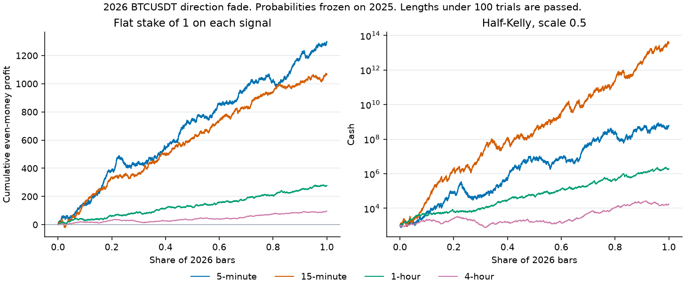

# Streak Kelly

Branching does not create positive expectancy when \(p \le 0.5\) under even money, and it does not remove the possibility of ruin under finite capital. It only changes the shape of the path.

Kelly does not create an edge either. It sizes a bet from a probability. The probability here is the chance that the next decisive Bitcoin bar reverses a streak, estimated on 2025 and frozen. The engine is paid even money on the direction bit. It is not paid the bitcoin return, and the stake below has no fee and no spread.

## The bet

An up bar is a decisive bar whose close is above its open. Flat bars are dropped. The state is the exact length of the run that just finished, not every overlapping pair inside it. A run of four ups is one trial at length 4. It is not also a fresh trial at length 2.

The stake that settles on bar \(t\) uses the streak ending at bar \(t - 1\). An up streak is faded with a short bet. A down streak is faded with a long bet. Each side has its own 2025 table. A side is bet only when that table clears the gate.

Even-money Kelly is

\[
f^{*} = 2p - 1.
\]

The stake is half of that fraction of current cash, the lab's Kelly scale of 0.5. Half of \(f^{*}\) is \(p - 0.5\). A length is used only when 2025 recorded at least 100 reversal trials and \(p > 0.5\). Otherwise the bar is passed. One hundred trials is about where a 55% estimate sits one standard error from a coin. The gate still lets through edges of a fraction of a percent when the sample is large.

Daily 2025 has 365 bars. No streak length reached 100 trials, so the daily book places no bets.

The streak is carried across New Year. Holdout cash starts again at 1,000 on the first 2026 bar. The probability table does not include 2026. Regenerate with `python src/streak_kelly.py`. The figure is `python src/plot_streak_kelly.py`.

## What 2025 was willing to fade

These are the cells with at least 100 trials and a fade rate above one half. The fraction is the half-Kelly stake, as a share of cash.

| Timeframe | Streak | Length | 2025 trials | 2025 fade rate | Half-Kelly fraction |
|---|---|---:|---:|---:|---:|
| 5-minute | Up | 2 | 13,368 | 0.507 | 0.73% |
| 5-minute | Up | 4 | 3,282 | 0.536 | 3.63% |
| 5-minute | Up | 8 | 153 | 0.575 | 7.52% |
| 5-minute | Down | 2 | 13,509 | 0.506 | 0.59% |
| 5-minute | Down | 4 | 3,215 | 0.550 | 4.96% |
| 15-minute | Up | 2 | 4,521 | 0.522 | 2.16% |
| 15-minute | Up | 6 | 192 | 0.620 | 12.0% |
| 15-minute | Down | 2 | 4,490 | 0.517 | 1.74% |
| 15-minute | Down | 6 | 210 | 0.629 | 12.9% |
| 1-hour | Up | 2 | 1,136 | 0.520 | 2.02% |
| 1-hour | Up | 5 | 124 | 0.573 | 7.26% |
| 1-hour | Down | 2 | 1,117 | 0.529 | 2.91% |
| 4-hour | Up | 2 | 287 | 0.526 | 2.61% |
| 4-hour | Up | 3 | 136 | 0.603 | 10.3% |
| 4-hour | Down | 3 | 133 | 0.594 | 9.40% |

The 5-minute table also fades up streaks of length 3, 5, 6, and 7, and down streaks of length 3, 5, 6, 7, and 8. The 15-minute and 1-hour tables fill in the lengths between the rows above. The full list is `results/streak_kelly.json`.

A fade rate of 0.507 on 13,368 trials is about 1.7 standard errors above one half. A fade rate of 0.536 on 3,282 trials is about four standard errors above one half. The long lengths are thinner: 153 trials at 0.575 is a wide interval.

## 2026, same stakes, frozen probabilities

The flat column bets 1 unit every time the gate says to bet. That column is the even-money edge without compounding. The Kelly column rebets a fraction of whatever cash is left. Both use the same signals. Ruin is zero in every row.

| Timeframe | Bets | Hit rate | Flat terminal | Flat max drawdown | Half-Kelly log-growth | Half-Kelly max drawdown |
|---|---:|---:|---:|---:|---:|---:|
| 5-minute | 38,136 | 0.517 | 2,298 | 6.1% | +13.30 | 91.1% |
| 15-minute | 25,963 | 0.521 | 2,071 | 5.8% | +24.41 | 79.7% |
| 1-hour | 4,741 | 0.529 | 1,277 | 1.6% | +7.58 | 43.3% |
| 4-hour | 1,044 | 0.546 | 1,096 | 2.3% | +2.88 | 76.9% |
| Daily | 0 |  | 1,000 |  | 0 |  |

A hit rate of 0.517 on a 1-unit even-money bet wins 0.034 units per bet. Over 38,136 five-minute bets that is about +1,298, which is the flat path from 1,000 to 2,298. The half-Kelly log-growth of +13.3 is that same edge resized on every bar: \(e^{13.3}\) times the starting cash, on the order of \(6 \times 10^{8}\). The path gave back 91% from its peak on the way there. The 15-minute Kelly path is the same kind of compounding, with a 80% drawdown.

The 2025 path is in-sample. The probabilities were counted on those bars, and the gate keeps the lengths that won in 2025, so that path is not a confirmation.

## Where the holdout kept the fade, and where it did not

On the 5-minute bars the up-streak fade held. Length 2 was estimated at 0.507 and came in at 0.510 (9,899 bets). Length 4 was 0.536 and came in at 0.530 (2,289 bets). Length 8 was 0.575 and came in at 0.604 (111 bets).

The down-streak fade was weaker. Length 4 was estimated at 0.550 and came in at 0.509 (2,287 bets). Length 5 came in at 0.492. Length 6 came in at 0.498. Those three cells were still bet, because the gate looks at 2025 only. The aggregate 5-minute hit rate stayed at 0.517 because the other cells carried it.

On the 15-minute bars every played length came in above one half. The longest, six in a row, was estimated near 0.62 and came in at 0.577 on the up side (142 bets) and 0.548 on the down side (155 bets). The 12% fraction on that cell is large next to a sample of about 200 trials.

On the 1-hour bars the down streak of length 1 was estimated at 0.502 and came in at 0.488 (1,715 bets). The fraction on that cell is 0.24% of cash. The longer 1-hour fades came in above one half, except the up streak of length 5, which fell from 0.573 to 0.514 on 70 bets.

On the 4-hour bars the five played cells all came in above one half. Length 3 was estimated near 0.60 on about 135 trials and came in near 0.57. That is 95 up-streak bets and 91 down-streak bets.

## What the book is, and what it is not

The book fades a streak when 2025 said the next bar reversed more often than a coin, and it sizes that fade with half-Kelly. On the 2026 even-money bit the flat stake of 1 finished ahead on every timeframe that had a sample large enough to bet. The hit rates are 0.517, 0.521, 0.529, and 0.546.

That is a description of this file under even money. The Kelly terminal assumes the whole bankroll can be resized, at even money, on the next 5-minute color, tens of thousands of times, with no cost. The drawdown on that path is most of the bankroll. Daily bars still do not have 100 trials at any length, so that book stands aside.

## What a few hundredths of a unit means

The 5-minute holdout placed 38,136 flat bets and won 19,717 of them. Each win pays +1 and each loss pays −1, so the year nets \(19{,}717 - 18{,}419 = +1{,}298\) units, which is 0.034 units per bet. That 0.034 is the whole edge. It is 3.4% of the 1-unit stake.

A cost taken out of every bet, win or loss, subtracts from that 0.034 before the year is added up.

| Cost per 1-unit bet | Expected profit left per bet | Over 38,136 bets |
|---:|---:|---:|
| 0 | +0.034 | +1,298 |
| 0.01 | +0.024 | +917 |
| 0.02 | +0.014 | +535 |
| 0.03 | +0.004 | +154 |
| 0.034 | 0 | 0 |
| 0.05 | −0.016 | −609 |

A cost of about three hundredths of a unit per bet leaves a sliver. A cost of 0.034 units per bet leaves nothing. A cost of five hundredths turns the year into a loss. "A few hundredths" is that gap, not a metaphor.

This cost is a share of the even-money stake. It is the vig, the fee, or the spread on a contract that pays 1:1 on the color of the bar. It is not an exchange fee quoted in basis points of bitcoin. The same 38,136 signals, scored on the bitcoin price instead of even money, earned an average signed return of +0.16 basis points per bet. The average absolute 5-minute move in 2026 was 8.7 basis points. A round-trip cost of 1 basis point of price already exceeds the price change those signals captured. The even-money table can show +1,298 units while a price bet on the same colors, after a small fee, does not.
